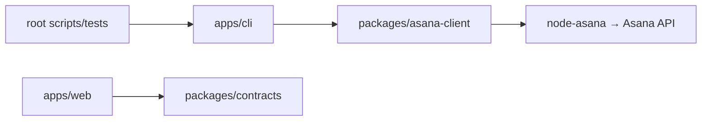

# Монорепозиторий

Репозиторий использует Bun workspaces и Turborepo. Одна установка из корня,
один `bun.lock`, общий `bunfig.toml` с карантином зависимостей 14 дней.
Версия Bun задана корневым `packageManager`; Turbo закреплён точно.

## Реализованная структура

До переноса:

```text
src/                       CLI и прямая работа с node-asana
web/                       самостоятельный frontend со своим bun.lock
web/src/model/board.ts      протокол сервиса вместе с правилами представления
```

После переноса:

```text
apps/
├── cli/                   @asana-cli/cli: команды, auth, policy, operation journal
│   ├── src/sdk.ts          перевод ошибок транспорта в CLI errors; credentials/redaction
│   └── dist/asana-cli      результат компиляции Turbo
└── web/                   @asana-cli/web: Vite, React, Jotai, компоненты и browser client
packages/
├── asana-client/           @asana-cli/asana-client: официальный node-asana, SDK dispatch
└── contracts/              @asana-cli/contracts: Zod DTO HTTP/WS, commands и receipts
scripts/                   генераторы, quality gates, release и qualification tooling
tests/                     CLI, security, release и compiled black-box integration tests
integrations/              metadata и renderer клиентских интеграций
skills/source/             авторитетные источники skills
generated/                 воспроизводимые outputs генераторов
evidence/                  датированные qualification records
dist/asana-cli             стабильный путь standalone artifact для release/black-box
```



`asana-client` не читает env, Keychain, настройки пользователя или БД. Его фабрика получает
токен и необязательный `baseUrl`; возвращает `AsanaTransport` с методом
`invoke(className, methodName, args): Promise<unknown>`. SDK client хранится в closure и не
возвращается потребителю. Пакет предоставляет список классов и методов, разрешает регистр
имён и запрещает вызов `constructor`/`WithHttpInfo`. Ошибки конфигурации адаптера имеют
собственный тип; HTTP-ошибки передаются потребителю для обработки в его контексте.

Динамический интерфейс нужен существующему `api call`, который предоставляет весь SDK.
API-specific DTO validation, bounded pagination, workflow и permissions сейчас остаются
в CLI. Это не обещание типизации каждого generated SDK endpoint. Для сервиса следует
выделять фактически используемые domain operations, сохраняя этот transport port для
подмены в тестах. Пример такой подмены есть в `tests/support/asana-fixture.ts`.

`contracts` содержит wire format доски: snapshots, events, actions, commands, receipts и
runtime validation. Он не зависит от SDK, Bun, React, Jotai или файловой системы; TypeScript
проверяет его без Node/Bun ambient types. Названия статусов на русском, сортировка,
фильтры и атомы остаются в web. `check:workspaces` запрещает прямой и транзитивный путь
из browser/contracts в Asana SDK или CLI и сверяет manifests с lockfile.

## Команды

Все команды ниже выполняются из корня:

```sh
bun install --frozen-lockfile
bun run dev                                  # только web dev server
bun run --filter @asana-cli/cli dev -- --help  # CLI из исходников
bun run build                                # Turbo builds + stage dist/asana-cli
bun run typecheck                            # все workspace packages + root tooling
bun run test                                 # package suites + CLI/release suites
bun run test:e2e                             # отдельный browser server, desktop/mobile
bun run check                               # полный существующий quality gate
bunx turbo run build --filter=@asana-cli/cli   # только CLI и его dependencies
```

Внутренние пакеты экспортируют TypeScript source: Bun и Vite собирают его в составе
приложения. Пустых library build tasks и дублирующих JS outputs нет. Turbo учитывает
workspace dependency graph, upstream typechecks, manifests/lockfile и root inputs для
CLI generators; кеширует `dist/**`. `dev` и E2E не кешируются. Vite proxy получает
`ASANA_SERVICE_URL` через явный dev passthrough; PAT не нужен браузеру или сборке.

Root `test` запускает package tests через Turbo и затем CLI/release tests; последним
нужен собранный `dist/asana-cli`. `bun run check` обеспечивает этот порядок. При
самостоятельном первом запуске тестов сначала выполните `bun run build`.

## Следующие границы

Это направления из service delivery plan, не созданные пустые пакеты:

| Будущий модуль | Ответственность | Разрешённые зависимости |
| --- | --- | --- |
| `apps/service` | Bun/Hono lifecycle, HTTP/WS, composition root, static assets | core, contracts, asana-client |
| `packages/core` | Детерминированные use cases, transitions, revision/idempotency | contracts и transport ports |
| SQLite/Drizzle adapter | Workflow metadata, inbox/outbox, queue, migrations | schema/core ports; подключается сервисом |
| MCP/plugin adapters | Одна модель команд для Claude/Codex clients | contracts и service client; без собственной business logic |

CLI и UI будут клиентами общего сервиса. Наличие Turbo не реализует daemon, persistence,
webhooks или remote gateway: эти этапы остаются в [delivery plan](service-delivery-plan.md).
Asana остаётся источником task data; SQLite не становится полной локальной копией Asana.

## Release и исторические проверки

Standalone binary, public CLI envelopes, platform matrix и root `dist/` сохранены.
SBOM обходит production dependencies `apps/cli` через workspace links и включает их
registry closure. React, Vite, Turbo и root test dependencies не попадают в SBOM CLI.
SDK version checker читает manifest пакета `asana-client`. Zod унифицирован на 4.6.7.

Client subject digest охватывает CLI source, adapter source/manifests, lockfile и прежние
integration/skill inputs. Старые evals не переименованы в результаты нового source digest.
Перед релизом нужна новая полная qualification матрица текущего binary.

Immutable `evidence/v1` проверяется по Git blobs исходного commit
`dd4760f8fc25215f9311f3eb1ea8c025137b562e`. Сам audit JSON также должен остаться byte-identical.
Проверка требует полной Git history и не утверждает безопасность нынешнего dependency tree.
Текущие проверки — frozen install, workspace boundaries, tests, SBOM и `bun audit --production`.

Fallow 3.4.2 new-only attribution не сопоставляет перемещённые пути. Чтобы перенос не
выдавал старые findings за новые, health/dupes baseline сгенерированы на pre-monorepo source
commit `c86fdc081319d1c6f250b6dd2b15b5ed28240f94`
и перенесены только по правилам `src/ → apps/cli/src/`, `web/ → apps/web/`.
Clone identities повторно сортируются после изменения путей. Прежний dead-code baseline
проходит ту же механическую миграцию. Значения метрик не увеличивались; findings нового
кода не принимались. Генератор — `bun run generate:fallow-migration`; outputs не редактируются
вручную. Health score ≥80, duplication ≤5% и regression gates продолжают действовать.

Для повторного получения source baseline после squash merge можно загрузить сохранённую
историю PR: `git fetch origin refs/pull/51/head:refs/remotes/origin/pr-51-history`.
