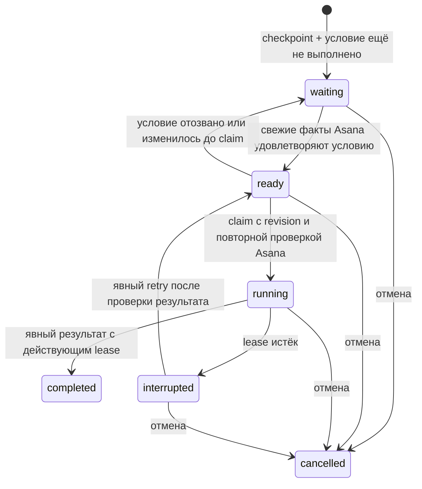

# Next: checkpoint, ожидания Asana и очередь продолжений

Экспериментальный slice после [локального watcher](next-local-tracking.md). Core сохраняет
работу в SQLite, ждёт конкретного изменения Asana и делает продолжение доступным человеку
или внешнему исполнителю. Встроенный запуск LLM, native session resume, coordinator assignments,
GitLab approvals и MCP/plugin wrappers этим slice не реализованы.

## Пользовательский путь

1. Открыть реальную задачу в доске.
2. Раскрыть «Сохранить работу и дождаться изменения».
3. Записать, что уже сделано и что выполнить после ожидания.
4. Выбрать завершение задачи или конкретный признак Asana.
5. Сохранить и закрыть страницу: core продолжает ждать.
6. После подтверждённого изменения работа появится как «Готово к продолжению».
7. Принять её кнопкой «Продолжить в этом окне» или через CLI.
8. Публиковать отчёт и завершить продолжение; Asana этим не изменяется.

В форме доступны секции и enum-значения, обнаруженные watcher. Это не полный справочник всех
проектных секций и вариантов полей. CLI принимает точные IDs, если нужное значение известно.
Ожидание значения `QA = Passed` пока **не доказывает проверку определённой сборки**: build/commit
correlation и проверка роли тестировщика требуют отдельного typed QA adapter. Не используйте
старое значение как подтверждение новой проверки: создание уже выполненного ожидания отклоняется.

## Состояния



Автоматический retry принятой работы отсутствует. `interrupted` означает отсутствие подтверждения
связи, а не доказанную остановку внешнего процесса. Перед ручным retry нужно проверить старого
исполнителя и внешние результаты. Cancel отзывает право отчитываться в core; он не убивает
произвольный внешний процесс и не откатывает его изменения.

`ready` — устойчивое состояние очереди, а не отдельный дублирующий queue record. Повторный source
event не создаёт вторую работу. `request_id` является ID работы: повтор того же create возвращает
её, повтор с другим содержимым отклоняется. UI сохраняет ID при повторе неизменённой формы.

Любая команда содержит `expected_revision`. Claim дополнительно содержит имя исполнителя и
случайный `lease_token`, сгенерированный вызывающей стороной. Core хранит только его SHA-256;
list/create/action responses не раскрывают hash. Token не является отдельной user identity:
экспериментальный API пока обслуживает одного доверенного OS/account owner.

Lease действует 90 секунд; heartbeat/report продлевает его. В браузере heartbeat отправляется
каждые 20 секунд и не считается отчётом о прогрессе. Закрытие страницы прекращает heartbeat;
после истечения срока работа станет interrupted. После reload token не восстанавливается из
browser storage — secrets не записываются в localStorage. Для длительного выполнения агент
должен использовать внешний исполнитель, владеющий token и отправляющий heartbeat.

## CLI для человека и внешнего исполнителя

Команды присоединяются к работающему сервису и сами его не запускают:

```sh
asana-cli-next service start
asana-cli-next work list
asana-cli-next work wait --input @wait.json
asana-cli-next work action <work-id> --input @action.json
```

`--input -` читает JSON из stdin. Примеры ниже синтетические; замените task/work IDs и revision
на реальные. Не размещайте PAT или другие credentials в checkpoint/report.

Пример `wait.json`:

```json
{
  "request_id": "11111111-1111-4111-8111-111111111111",
  "task_gid": "123456789",
  "condition": { "kind": "choice", "choice_id": "section:987654321" },
  "checkpoint": {
    "summary": "Исправление подготовлено, проверки пройдены",
    "next": "Проверить результат QA и выбрать следующий шаг",
    "repository": "/path/to/worktree",
    "branch": "feature/example",
    "commit": "abcdef0123456789"
  }
}
```

Другие условия: `{"kind":"completed"}` или
`{"kind":"choice","choice_id":"enum:<field-gid>:<value-gid>"}`.
Один record содержит одно условие; AND/OR, deadlines и эскалации пока отсутствуют.

Пример claim для работы с revision 2:

```json
{
  "kind": "claim",
  "expected_revision": 2,
  "worker": "backend-worker",
  "lease_token": "22222222-2222-4222-8222-222222222222"
}
```

Token должен быть новым случайным UUID для каждого запуска; значение выше только пример.
Сохраните token у исполнителя до отправки claim. Дальше используйте возвращённую revision:

```json
{
  "kind": "report",
  "expected_revision": 3,
  "lease_token": "22222222-2222-4222-8222-222222222222",
  "summary": "Проверяю результаты тестирования"
}
```

`heartbeat` имеет те же revision/token без summary. `complete` имеет те же поля, что report,
но закрывает продолжение. `cancel` и `retry` требуют только kind и expected_revision.
Каждая успешная операция возвращает новую revision; параллельные команды могут получить conflict.
При неоднозначном результате перечитайте list и проверьте исполнителя: автоматического повтора
принятой работы нет. Долгий LLM turn должен иметь независимый heartbeat от runner, а не надеяться,
что модель вспомнит вызвать tool вовремя.

Agent mode включается host через `ASANA_CLI_AGENT=1` или явный `--agent`.
В agent mode list разрешён при read policy. Workflow mutations требуют
`ASANA_CLI_AGENT_POLICY=read-write`, заданного **host**, а не скрыто изменённого самим агентом.
Это local workflow effects, не permission на удалённую запись Asana. Существующие prepare/apply
и host approval для прямых Asana writes этим не меняются. Новые операции пока не входят в
квалифицированный agent-v2 action catalogue или автоматически установленные skills.

## API, persistence и общий watcher

- `GET /api/v1/work` — bounded список и lease duration.
- `POST /api/v1/work` — strict create input.
- `POST /api/v1/work/:id/actions` — strict discriminated action.
- Browser использует existing session + CSRF; native CLI — owner-only discovery bearer.
- Ошибки: 422 invalid input/limit, 409 revision/condition/lease/state conflict, 404 unknown work,
  503 source unavailable. Ошибка Asana не считается выполнением условия.

```text
До                                  После
SQLite settings                     SQLite settings + work_items
RAM-only interests                  workflow:<id> восстанавливается из БД
закрытие view освобождает lease      закрытие view не отменяет ожидание
нет продолжений                     waiting → ready → claimed run → result
```

`work_items` хранит версионированный собственный record: исходную ссылку/название, checkpoint,
условие, факт проверки, текущий run и последний отчёт. Это не полный task mirror и не transcript.
История всех запусков/отчётов и coordinator ownership epochs появятся отдельным этапом.
Лимит первой реализации — 500 сохранённых records, включая закрытые; архивирование/retention
ещё не реализованы. Restore восстанавливает interests только незакрытых работ.

Generated Drizzle migration поднимает schema version с 1 до 2 в транзакции. Старый next binary
с version guard откажется писать в v2; возврат требует совместимого binary или backup БД.
Стабильный direct CLI использует отдельное состояние и не мигрирует эту БД.

Работа удерживает `workflow:<id>` interest независимо от UI и background discovery. Задача может
выйти из выборки «назначена мне» и остаться в наблюдении ожидания. Source observations поступают
из общего Events scheduler и discovery. Claim делает дополнительное свежее чтение Asana;
отозванное условие возвращает record в waiting. При завершении/отмене снимается только interest
этой работы; другие consumers сохраняются. После рестарта source cursors получаются заново.

## Проверки и оставшийся scope

Runtime tests проверяют v1 migration, restart, unassigned resource interest, Events → ready,
idempotent create, duplicate source events, fresh claim rejection, revision fencing, token mismatch,
lease expiry/interrupted и explicit retry/cancel. Browser tests проверяют создание, reload,
ручное принятие и завершение на desktop/mobile. Agent policy проверяется отдельно.

Следующий этап: полноценные назначения/запуски/checkpoint updates, scoped runner adapter и его
жизненный цикл; затем GitLab conditions и version-correlated QA. Этот slice не запускает
процессы моделей, не обещает resume чужих desktop-сессий и не выдаёт complete за Asana completion.
