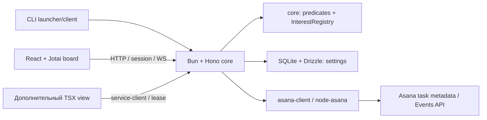

# Next: локальное отслеживание реальных задач

Статус: экспериментальная реализация в ветке `feat/local-service-target`, 2026-11-03.
Это работающий read-only watcher, а не завершение всего [целевого продукта](service-target-state.md).
Он не опубликован как новый stable release. Название локального executable `asana-cli-next`
позволяет проверять его рядом с установленным stable `asana-cli`.

## Пользовательский запуск

Существующий PAT берётся из credential manager CLI или `ASANA_ACCESS_TOKEN`.
Он должен принадлежать пользователю, чьи назначения нужно отслеживать.

```sh
# Пример: собрать из checkout, установить отдельное next-имя.
bun install --frozen-lockfile
bun run build
install -m 755 dist/asana-cli ~/.local/bin/asana-cli-next

asana-cli-next service start
asana-cli-next board open
asana-cli-next service status
asana-cli-next board list
asana-cli-next service stop
```

`service start` запускает отдельный процесс того же binary; выход терминала его не останавливает.
Повторный start присоединяется к работающему сервису. PID locks предотвращают второй экземпляр;
параллельный старт может получить сообщение «already starting/running», после него можно повторить
status/start. `service run` — foreground режим диагностики. `board open` также делает explicit start.
`board list`, `board sources` и status сами сервис не запускают. После stop только явный запуск
возобновляет работу. Системный login/autostart и Electron launcher пока не поставляются.

Bun runtime, Hono, сгенерированная SQLite migration и Vite assets встроены в binary. На машине
пользователя Bun/Node, исходники, Vite и агент не нужны. Core слушает только `127.0.0.1`
на свободном порту; CLI узнаёт его из owner-only discovery file в `next-service` рядом с каталогом
operation journal. `doctor` показывает базовый state path. Смена Asana account на существующей
БД отклоняется, чтобы не смешивать локальную конфигурацию разных пользователей.

Браузер подключается через одноразовый bootstrap code в URL fragment (TTL 60 секунд), который
немедленно удаляется из address bar и обменивается на HttpOnly SameSite=Strict cookie (12 часов).
Повторное использование code отклоняется. PAT не попадает в browser/API response/discovery file:
родитель передаёт его дочернему core через stdin. Native discovery хранит отдельный local bearer;
это тоже credential, и файл имеет права 0600, каталог 0700. API проверяет Host/Origin, мутации
browser session требуют CSRF. После истечения сессии нужно снова выполнить `board open`.
Ввод/сохранение PAT из веб-формы и Asana OAuth ещё не реализованы.

## Как определяются «мои текущие задачи»

Никакая модель не классифицирует задачи. Core получает текущего пользователя и до 500 назначенных
ему незавершённых задач **на workspace**, затем применяет сохранённое правило:

```text
назначена мне AND completed=false
  AND хотя бы одна секция проекта нормализуется в todo / inprogress / codereview
```

Нормализация убирает пробелы/дефисы и приводит к нижнему регистру: `To Do`, `In Progress`,
`In progress`, `Code review` совпадают. Это удобный начальный preset, а не универсальная
семантика любой команды: `Review Dev` или `On Test` автоматически не приравниваются к code review.
В UI можно выбрать все незавершённые или свой набор реальных секций/enum-значений. Отображаются
имена проектов, секций, полей и число задач, а не поле ручного ввода Asana GID. Несколько выбранных
признаков объединяются через OR, задача в нескольких секциях не дублируется. Custom без выбранных
признаков даёт пустую выборку. Новые назначения обнаруживаются при сверке раз в минуту.

Если upstream discovery достигает лимита, UI сообщает об усечении: это не полная выборка аккаунта.
Доска показывает первые 100 выбранных задач; счётчик и предупреждение отражают этот предел.
Правило задаёт фоновой интерес пользователя: закрытие основной страницы не отменяет watcher.
Это не меняет секции/поля самих задач в Asana.

В [afisha !1398](https://gitlab.frhc.one/ticketon-fho/frontend/afisha/-/merge_requests/1398)
Query Kit различает активность query consumers через hooks/`enabled` и их lifecycle.
Это объясняет, **кому сейчас нужны данные**, но само по себе не определяет бизнес-понятие
«активная задача Asana». Здесь обе части разделены: детерминированный predicate выбирает задачи,
а registry интересов объединяет потребности фонового профиля и открытых views.

## Общая схема и жизненный цикл view



Один resource GID имеет один Events cursor и один scheduler независимо от количества consumers.
`background:my-work` держит выбранные задачи. Каждое view WS-соединение получает отдельного owner.
Закрытие/размонтирование view освобождает только его интерес; общий ресурс продолжает обновляться,
если нужен фоновому профилю или другому view. Heartbeat каждые 10 секунд продлевает lease на 45
секунд; при потере сети без close TTL освобождает её. Запрос, завершившийся после закрытия view,
не может заново создать lease. Invalidation рассылается только заинтересованным view consumers.

В деталях задачи есть «Граф зависимостей»: отдельная вкладка использует реальные `dependencies`,
строит ограниченный граф и временно добавляет его узлы к отслеживанию. Depth ограничен тремя
слоями, ширина — 12 узлами на слой; oversized graph получает `truncated`. Это пример extension,
использующего общие metadata, scheduler и lifecycle, без своего PAT и Asana poller.

### Агент добавляет доверенный source view

Сейчас агент может добавить TSX-компонент в checkout и импортировать `@asana-cli/service-client`.
Проект остаётся обычным TypeScript/React/Vite приложением; state хранится в Jotai. Например,
функция, вызванная внутри `useEffect`, должна **возвращать disposer**:

```ts
import { watchTasks, watchDependencyGraph } from '@asana-cli/service-client';

// Пример: taskIds и handlers получены из состояния компонента, не из PAT.
function attachTasks(taskIds: readonly string[], refresh: () => void) {
  return watchTasks(taskIds, refresh);
}
function attachGraph(root: string, handlers: Parameters<typeof watchDependencyGraph>[1]) {
  return watchDependencyGraph(root, handlers);
}
```

Metadata доступны через session-authenticated `GET /api/v1/tasks/:gid`; capabilities — через
`GET /api/v1/capabilities`. `watchTasks` принимает до 50 task IDs на view; новый набор создаётся
после dispose старого. Graph helper сам перечитывает граф после invalidation. Каждое соединение
фиксирует свой descriptor, arbitrary protocol packets закрывают соединение. PAT/native bearer
не должны передаваться в source view. SDK не делает автоматического reconnect графа: при разрыве
показывается состояние, пользователь обновляет страницу. Основная доска имеет свой reconnect.

Установка произвольного HTML из агента, manifest/registry, grant scopes, sandbox bridge и динамическая
активация пакета ещё не реализованы. Доверенный TSX в основном приложении имеет доступ к browser
session; это не изоляция недоверенного кода. Полный контракт — [extensible views](service-extensible-views.md).

## Что хранится локально и как приходят изменения

SQLite содержит только KV settings: tracking rule, account binding и признак ручной
остановки. Schema описана в `packages/local-runtime/src/schema.ts`, SQL сгенерирован Drizzle Kit,
reviewed migration встроена в executable и применяется в транзакции с version guard.
Task metadata, candidates, графы, интересы consumers и Events cursors живут в RAM.
После рестарта core заново читает Asana и получает свежие sync tokens. PAT в SQLite не хранится.
Это не offline task database и не копия Asana.

Синхронизация сейчас — **периодические запросы Asana Events API**, не входящие webhook callbacks.
Начальный/просроченный cursor обрабатывается через 412/reset. Node SDK collection response
нормализуется внутри adapter; UI не видит SDK internals. Scheduler выполняет максимум один Events
запрос за двухсекундный tick (до 30 в минуту), не чаще раза в 30 секунд на ресурс. Discovery и
metadata requests имеют отдельные вызовы, поэтому это не общий лимит всех HTTP requests.
С ростом числа ресурсов задержка растёт; мгновенная доставка не обещается. Сверка назначений
каждые 60 секунд восстанавливает пропущенные изменения. При ошибке состояние/freshness
показывают проблему, последняя RAM-проекция может оставаться доступной.

## Границы первой реализации

- Работают lifecycle, browser session, read-only board, настройки discovery, общий Events watcher,
  generic task leases и dependency view.
- Прямой CLI по-прежнему умеет изменять Asana согласно существующим правам/agent policy.
  Новый web/core пока явно объявляет `asana_mutations: false`, а не имитирует записи.
- Workflow command journal/idempotency, webhook ingress, GitLab adapter, MCP/плагины, OAuth/gateway,
  мобильный доступ и Electron остаются в [плане](service-delivery-plan.md). SVC-001–004 реализованы
  частично; их полные acceptance criteria этим watcher slice не закрыты.
- Local next smoke проверяет подключение конкретного пользователя на macOS. Он не заменяет
  release qualification всех платформ и шести AI-клиентов. Private task contents/PAT не публикуются
  как test fixtures или evidence.
