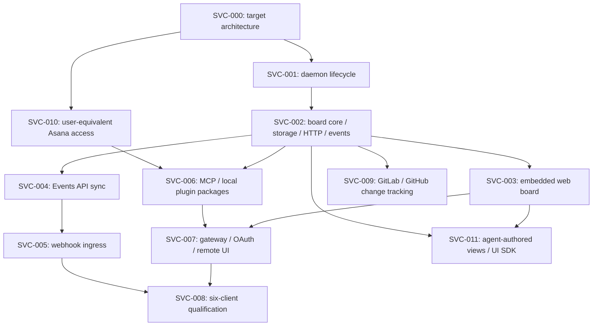

# План реализации сервиса, доски и плагинов

Статус: новый product scope, 2026-11-03. Это план последовательных проверяемых PR, без назначения
номера релиза до квалификации. Текущие v1 guarantees и historical evidence остаются в силе.

Реализованный [next watcher](next-local-tracking.md) покрывает часть SVC-001–004:
lifecycle/session, SQLite settings, embedded UI, Events API и view leases. Это не закрывает
полные workflow, production/release acceptance и остальные этапы.

Authoritative design:

- [Целевое ядро, daemon и доска](service-target-state.md).
- [Плагины, шесть клиентов и удалённый доступ](service-client-integrations.md).
- [Процесс без агентов, минимальная SQLite и default user-equivalent права](service-workflow-and-storage.md).

Задачи используют стабильные IDs `SVC-*`; GitHub Issues хранят текущее выполнение, ссылки и решения.
Этот документ владеет scope и acceptance criteria; issues ссылаются на него, не копируют весь дизайн.
Статусы в [backlog](backlog.md) обновляются только по фактическому результату. Ниже этапы, а не
утверждение о наличии runtime implementation.

GitHub tracking: [epic #52](https://github.com/ggkguelensan/asana-cli/issues/52),
[architecture PR #51](https://github.com/ggkguelensan/asana-cli/pull/51).

| Workstream | GitHub Issue |
| --- | --- |
| SVC-001 | [#53](https://github.com/ggkguelensan/asana-cli/issues/53) |
| SVC-002 | [#54](https://github.com/ggkguelensan/asana-cli/issues/54) |
| SVC-003 | [#55](https://github.com/ggkguelensan/asana-cli/issues/55) |
| SVC-004 | [#56](https://github.com/ggkguelensan/asana-cli/issues/56) |
| SVC-005 | [#57](https://github.com/ggkguelensan/asana-cli/issues/57) |
| SVC-006 | [#58](https://github.com/ggkguelensan/asana-cli/issues/58) |
| SVC-007 | [#59](https://github.com/ggkguelensan/asana-cli/issues/59) |
| SVC-008 | [#60](https://github.com/ggkguelensan/asana-cli/issues/60) |
| SVC-009 | [#61](https://github.com/ggkguelensan/asana-cli/issues/61) |
| SVC-010 | [#62](https://github.com/ggkguelensan/asana-cli/issues/62) |
| SVC-011 | [View authoring contract](service-extensible-views.md); implementation pending |

## Зависимости и release slices

| Slice | Включает | Условие завершения |
| --- | --- | --- |
| Local board | SVC-001–004 | Отдельный daemon, CLI/UI consistency, live board и Events API recovery |
| Webhook sync | SVC-005 | Безопасный ingress, lifecycle подписок и сверка |
| Local plugins | SVC-006 | Curated MCP и проверенные local packages, direct CLI сохранён |
| Permission parity | SVC-010 | Default access равен правам Asana user, optional restrictions явные |
| Remote access | SVC-007 | Gateway/pairing/OAuth, scoped remote UI и offline semantics |
| Six clients | SVC-008 | Реальные evidence records для каждой заявленной поверхности |
| Change requests | SVC-009 | SDK/glab ports, shared refresh/hooks и independent MR/CI freshness |
| Custom views | SVC-011 | Agent-authored HTML/TSX, reusable UI/SDK, grants и host bridge |

Remote release не объявляется готовым по local E2E. Первая local версия не ждёт gateway hosting,
marketplace publication или embedded widgets. Package publishing, hosting deployment и новый
release выполняются отдельными явно назначенными действиями после review/qualification.

[Launch/auth audit](service-launch-and-auth-audit.md) фиксирует общий Bun runtime в binary,
local PAT onboarding и owner-authorized browser bootstrap. Первый runtime deliverable должен
замкнуть human start → connect → board → stop до plugin/Electron/remote packaging.

## SVC-000 — Архитектурный контракт

Deliverables: два связанных design documents, актуальная навигация и этот implementation plan.
Решения различают текущие возможности, будущие контракты и неподтверждённую client compatibility.

Acceptance:

- описаны authority, identities, effects и boundaries каждой поверхности;
- есть before/after structure, жизненный цикл процесса, событий и подписок;
- определены шесть клиентов, два Codex Mobile mode и ограничения local/cloud;
- отсутствуют claims о готовом daemon/MCP/plugin/mobile runtime;
- Markdown links и существующие repository gates проверены без изменения client evidence.

## SVC-001 — Управление локальным daemon

Зависимость: SVC-000. Вход — существующий standalone executable и path/security conventions.

Deliverables: human `service start/run/status/stop/restart/logs`, authenticated discovery,
single-instance lock, instance handshake, signal/drain, bounded startup timeout. Runtime mode
поддерживает compiled binary и source installation. Никакого Asana polling и UI на этом шаге.

Acceptance:

- binary black-box start переживает завершение родителя и закрытие stdio;
- два concurrent start создают один процесс, stale discovery и version mismatch обработаны;
- stop проверяет instance, не убивает unrelated PID и оставляет состояние на диске;
- read/agent commands не стартуют service и не получают lifecycle scope;
- временный HOME/state root, cleanup tests и no-secret error fixtures;
- новый source digest имеет обновлённое qualification evidence по правилам репозитория.

Дополнительные acceptance SVC-001 по аудиту:

- один Bun composition root в `packages/local-runtime`, executable mode `asana-cli service run`;
- credential module общий с CLI; startup без PAT/сети открывает setup-required UI;
- concurrent CLI/plugin/Electron ensure создаёт один instance; manual stop блокирует auto-ensure;
- detached child переживает exit родителя; bridge не наследует PAT неявно; версии проверяются handshake.

## SVC-002 — Ядро доски, SQLite/Drizzle и транспорт

Зависимость: SVC-001. Persistence stack: SQLite через `bun:sqlite` + Drizzle ORM.
Реализовать Drizzle schema, generated SQL migrations и core operations для work items, ownership,
sessions, command receipts, revision CAS, outbox. HTTP/WebSocket — adapters этого interface.
Prepare/apply journal остаётся существующим; network mutation не дублируется в новом store.

Acceptance:

- track/untrack/list/typed transitions/handoff используют canonical IDs и effect scopes;
- phase и requests/blockers разделены, display status вычисляется; available_actions и guards общие для CLI/UI/агентов;
- полный human workflow работает без MCP, sessions и model credentials; решения transition logic воспроизводимы;
- task/review с одной Asana task сосуществуют, разные MR не схлопываются;
- локальная mutation и outbox event атомарны, повтор request ID не создаёт новую операцию;
- snapshot/cursor/replay исключают gap; expired cursor и slow consumer требуют resync;
- ownership epoch защищает от старой сессии после handoff;
- storage permissions, migrations/downgrade и bounded retention проверены;
- Drizzle schema владеет DB types/constraints, Zod — внешними contracts; raw rows не выдаются клиентам;
- Drizzle Kit используется только при разработке; reviewed migrations входят в binary и применяются без Kit/source checkout;
- schema/migration drift, upgrade с сохранением данных и atomic state/outbox transaction проверены;
- SQLite сохраняет свой workflow/recovery state; source metadata cache по умолчанию in-memory, disk projection opt-in;
- Asana-owned workflow fields не получают конкурирующий local статус; mapping явно определяет authority;
- очистка cache не теряет local phase/requests; notes/comments/raw SDK payloads и secrets не сохраняются автоматически;
- CLI black-box и transport tests обращаются к тому же core, без UI-only правил.

До merge зафиксировать численные budgets в schema/config и генерируемом capabilities contract.

## SVC-003 — Веб-доска из embedded assets

Frontend slice реализован в [apps/web/](../apps/web/README.md): TypeScript, React, Jotai, Vite,
компоненты доски и validation/client/controller layers. Есть disposable demo и API-fixture
browser tests. Next watcher добавляет real daemon/session/API и embedded assets. Полные
workflow actions и весь qualification scope SVC-003 ещё не закрыты.

Зависимость: SVC-002. Самостоятельная responsive доска по композиции референса, без зависимости
от Artifact DB и Claude session ID. Перенос UI предусмотрен запросом пользователя; применимые
license notices сохраняются, внешние assets проверяются и адаптируются к embedded distribution.

Acceptance:

- onboarding, четыре зоны, detail view, ownership, freshness, connection и stopped states;
- действия CLI и UI дают одинаковые revisions/receipts; конфликт сохраняет пользовательский ввод;
- bootstrap/session auth, Host/Origin/CSRF, logout/revocation и XSS fixtures;
- owner-only local PAT setup, общий OS store CLI/runtime, account verification и отсутствие PAT readback;
- service unauthorized, Asana credential missing/revoked, network failure и locked store различаются;
- failed setup не затирает рабочий PAT; secret не попадает в board state, logs/WS/storage и agent output;
- WebSocket reconnect/resync, service stop из UI, no browser offline mutation queue;
- keyboard/focus, reduced motion, темы, 360 px layout и no external trackers;
- compiled binary отдаёт assets без source checkout и frontend dev server;
- browser E2E evidence с fixtures; приватные данные и реальные session IDs не публикуются.
- полный flow выполняется человеком без агента; «обновить source», local transition и agent-help — разные действия;

## SVC-004 — Events API и сверка активных задач

Зависимость: SVC-002. Manual tracking плюс opt-in bounded assignment/project discovery.
Сохранённые cursors/inbox, task snapshot cache, source freshness, reconciliation и request budget.

Acceptance:

- 412/initial sync/has_more и durable cursor advance проверены;
- snapshot + subscription ordering не теряет изменения во время bootstrap;
- crash после сохранения batch до обработки восстанавливается;
- 401/403/404/429/timeout/offline/wake имеют bounded retries и понятные состояния;
- потеря доступа не выдаётся за доказанное удаление;
- stale sync не обозначается как fresh из-за live WebSocket;
- no-content default и content budgets совпадают с существующим agent contract.
- source projections не превращаются в persisted Asana mirror; freshness/unknown после restart без cache проверены;

Существующий `LTR-003` — более ранняя research идея; её service scope уточняется этим этапом,
но research запись не помечается выполненной до реальной реализации.

## SVC-005 — Webhook ingress и subscription lifecycle

Зависимость: SVC-004. Реализовать SDK create/list/delete, desired/observed reconcile,
локальный ingress и явную настройку публичного callback. Туннель не поднимается скрыто.

Acceptance:

- listener/pending subscription готовы до SDK create; handshake во время create проходит;
- raw-body HMAC, неизвестный correlation ID, oversized body, empty heartbeat и retries проверены;
- durable inbox до success response, async refresh и event coalescing;
- callback rotation, hook deletion, PAT revoke, untrack и duplicate startup не создают orphan hooks;
- используются только owned subscriptions, сохраняется Events/snapshot fallback;
- webhook ingress не раскрывает admin/board endpoints.

## SVC-006 — Curated MCP и локальные plugin packages

Зависимости: SVC-002, SVC-010. Общие typed tools, stdio bridge, canonical board workflows и deterministic
native packages для Claude Code, Codex CLI и проверяемых desktop-local routes.

Acceptance:

- tools не экспортируют raw API, auth, arbitrary file/shell и daemon kill;
- stdio stdout содержит только MCP; закрытие bridge не останавливает daemon;
- default attach-only, opt-in ensure через общий launcher и persistent manual-stop latch;
- capability/effect scopes, typed errors, bounded tool output и no-PAT bridge;
- immutable prepare/apply сохраняет существующий external approval для local clients;
- generators, ownership/dry-run/update/uninstall, native format validation и package tests;
- actual native local discovery tests; desktop отсутствие evidence остаётся explicit limitation;
- существующий managed skill/direct CLI путь остаётся рабочим.
- agents используют capabilities → exact resolve → state/available_actions → typed action → receipt;
  conflict/timeout/unknown не вызывают скрытого semantic retry, self-approval или raw fallback;

Изменение source/skills/integrations требует client и lifecycle evidence refresh; нельзя вручную
переименовать старые записи в новую MCP qualification.

## SVC-007 — Удалённый gateway, OAuth и remote UI

Зависимости: SVC-003, SVC-006. Отдельный runtime/deployment artifact, public MCP endpoint,
outbound daemon connection, scoped projection, human authentication, pairing и revocation.

Acceptance:

- user/tenant/device/workspace/effect isolation с cross-tenant negative tests;
- pairing single-use/expiry/local consent и separate OAuth/device credentials;
- минимальная read projection, явная freshness, ограниченная transport queue;
- offline mutation не становится success; replay проверяет актуальные policy/ownership;
- отдельное human server-verifiable operation approval; агент не может self-approve;
- revoke закрывает sessions и не даёт исполнить старые approval grants;
- remote UI HTTPS cookies/CSRF/CSP и lifecycle scope; restart не обещается без host runner;
- recovery, retention/erase, encrypted secret storage и production deployment instructions.

До production rollout выбрать hosting/identity provider и выполнить отдельную security review.
Не разворачивать публичный сервис и не публиковать private board в рамках architecture PR.

## SVC-008 — Qualification шести клиентов

Зависимости: SVC-005, SVC-007. Actual-client evidence и генерируемая multidimensional compatibility
матрица по [integration design](service-client-integrations.md). Это release gate remote scope,
а не блокировка раннего local release.

Acceptance:

- Claude Desktop local extension и remote Chat routes проверены отдельно;
- Claude Mobile remote connector проверен на реальном supported mobile mode;
- Claude Code CLI plugin и существующий skill путь не смешивают evidence;
- Codex Desktop native package и available transport проверены;
- Codex Mobile host session и Chat/Work remote-plugin mode имеют отдельные результаты;
- Codex CLI native plugin/stdio и direct CLI проверены отдельно;
- discovery/read/local-write/approval/apply/offline/revoke/malicious content сценарии сохранены;
- unsupported/pending surfaces не рекламируются supported и получают fallback URL.

Embedded UI resources добавляются только после подтверждения host/mobile capability; полная web
board доступна независимо от этого. Marketplace listings/publication требуют отдельного действия.

## SVC-009 — GitLab/GitHub API, MR/PR, CI и subscriptions

Зависимость: SVC-002. GitLab/GitHub adapters для явно связанных canonical change refs.
Provider auth отделён от Asana credential, arbitrary hosts не выбираются из task content.
[GitLab contract](service-gitlab-integration.md): primary Gitbeaker adapter, explicit alternative
`glab api` transport, общие typed ports, webhook + обязательный polling/reconciliation.

Acceptance:

- GitLab и GitHub identity включают host + project + number;
- CI/approvals/threads/merged имеют independent freshness и source provenance;
- bounded refresh, provider permissions, rate limit и stale/offline outcomes;
- task с несколькими изменениями не становится done после merge одного;
- review карточка показывает ожидаемое действие без автоматического approve/merge;
- SDK и glab adapters имеют explicit host/actor, bounded IO, validated DTO и no hidden write retry;
- polling-only работает без hook-management rights; hooks shared/refcounted, только owned IDs;
- webhook duplicate/out-of-order/failure/revoke и scheduler restart проверены;
- GraphQL subscriptions не обещают полное покрытие; MR notification subscribe не считается event stream;
- base board и новые views используют один scheduler/watch projection без N дополнительных hooks/pollers;
- fixtures обезличены, реальный self-hosted GitLab credential не попадает в GitHub.

## SVC-010 — Default Asana access по правам пользователя

Зависимость: SVC-000. Отдельная миграция текущего agent authorization/default profile и расширение
versioned operation catalogue. Целевой default — все поддерживаемые публичным API операции,
разрешённые пользователю/credential. Подробная модель — в
[workflow and storage](service-workflow-and-storage.md).

Acceptance:

- нет обязательного self-assignment или board/project filter как Asana authorization;
- API inventory покрывает доступные resources/writes; unsupported implementation и provider denial различимы;
- read-only/узкие scopes — явный выбор, approval не скрывает существующие capabilities;
- policy, action schemas, capability registry, skills, docs/help и evidence меняются согласованно;
- foreign-assignee/unassigned permitted writes, 403, OAuth scope denial, optional restrictions,
  exact target, stale inputs и ambiguous remote outcome имеют positive/negative tests;
- старые default и guards не объявляются снятыми до реальной миграции и qualification.

## Проверки и PR дисциплина

Каждый implementation PR оставляет main выпускаемым. Обязательны соответствующие schema,
public CLI black-box tests, docs/help и repository gates. Changes в digest-bound trees требуют
реальной requalification. Dependency additions проходят существующий quarantine, lockfile и SBOM
правила. Для architecture-only PR достаточно существующих gates; новые mirror-tests на prose
не добавляются.

В PR показывать final structure before/after, изменённые trust boundaries, выполненные checks
и material limitations. Не выдавать сохранённый design за runtime demo. Дальнейший progress
отмечается в GitHub Issues и связанных PR, без переписывания исторических release records.

## SVC-011 — Agent-authored views и reusable UI/SDK

Зависимости: SVC-002, SVC-003; provider-specific views используют capabilities SVC-009.
Контракт: [extensible views](service-extensible-views.md). Реальная runtime integration ещё
не реализована; новые package skeletons и fake support claims не создаются.

Deliverables: извлечённые presentation UI modules и service client, typed view SDK, authoring
skill/template, versioned capability catalogue, static HTML manifest/registry, isolated frame
host bridge, atomic activate/disable/rollback и view settings/provenance metadata.

Acceptance:

- агент создаёт новый layout/form/chart и использует готовые BoardView/карточки без копирования business rules;
- TS/TSX source → build → static HTML/assets; core не исполняет build/install scripts;
- SDK query/command/watch берут schemas из core catalogue; unknown capabilities дают явную ошибку;
- HTML работает в нашем host; сторонние artifact surfaces и file URLs не получают auth автоматически;
- custom frame не получает PAT, service cookies/control token или raw board CSRF metadata;
- operations используют общие handlers/revision/idempotency/receipts и host approval;
- lifecycle, forged protocol, revoke, incompatible bundle, offline/resync и browser isolation tested;
- сохраняются view registry/grants/settings, а не task mirror, private chat или API credentials;
- готовый view работает после завершения агента; отсутствие custom views не ломает основной human flow.
