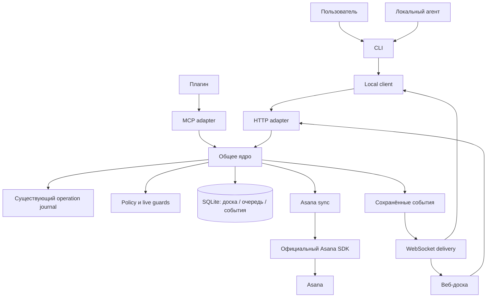

# Целевое состояние: ядро, фоновый сервис и веб-доска

Статус: архитектурное предложение для следующего product scope, 2026-11-03.
Это целевой контракт, а не описание уже доступных команд. В [apps/web/](../apps/web/README.md) реализован
самостоятельный TypeScript/React/Jotai/Vite frontend; daemon и его API пока отсутствуют.
Текущая CLI реализация описана в
[architecture](architecture.md). Плагины и возможности клиентов определены отдельно в
[client integrations](service-client-integrations.md); порядок разработки — в
[delivery plan](service-delivery-plan.md). Детерминированный процесс без агентов и минимальный
состав SQLite определены в [workflow and storage](service-workflow-and-storage.md).

Контракт поставки, запуска и PAT/browser onboarding уточнён в
[аудите топологии](service-launch-and-auth-audit.md); при различии деталей запуска/auth
используется этот контракт. Он отделяет текущий source от будущего runtime.

## 1. Результат для пользователя

`asana-cli` становится локальным центром ведения задач. Пользователь может работать из терминала,
браузера и подключённых AI-клиентов. Все они видят одну доску и используют одинаковые операции.
Смена агента или закрытие его сессии не теряет задачу, ожидания, MR и следующий шаг.

Один устанавливаемый executable содержит CLI, foreground-режим фонового сервиса, статические
ресурсы доски и в дальнейшем локальный MCP bridge. Для использования релизного binary не нужны
отдельно установленные Node, Bun, frontend dev server, PostgreSQL или Redis.

Основной сценарий:

1. Пользователь настраивает Asana credential существующим способом.
2. Запускает `asana-cli service start`, затем `asana-cli board open`.
3. Выбирает workspace и источники обнаружения задач; видит предварительный список.
4. Добавляет задачи в отслеживание, задаёт ожидания и связывает MR/PR при необходимости.
5. Ведёт процесс через CLI или доску; при желании подключает Claude/Codex и рабочие сессии.
6. Изменение состояния появляется на других клиентах без ручного обновления страницы.
7. Закрывает терминал или агента; ядро продолжает синхронизацию.
8. Останавливает сервис явной командой из CLI или кнопкой доски; данные сохраняются.

Ни один обязательный шаг не требует агента или coordinator session. Доступные действия и guards
вычисляет ядро. Default Asana access соответствует правам пользователя; дополнительные local
ограничения включаются явно. Предпросмотр/approval записи и доступность операции — разные понятия.

Мобильный доступ добавляется через отдельный удалённый шлюз или через поддерживаемое платформой
управление подключённым компьютером. Установка плагина сама по себе не делает localhost доступным
телефону. Удалённый шлюз — отдельный deployment artifact из этого же репозитория, без обязательной
зависимости локального режима от облачной инфраструктуры.

## 2. Что берём из исходной доски

Источником продуктового смысла служит
[Ticketon claude-plugin MR !4](https://gitlab.frhc.one/ticketon-fho/backend/tools/claude-plugin/-/merge_requests/4/diffs).
В нём доска «Окна задач» использует базу артефакта Claude и конкретный ID координатора.

| Элемент | Целевое поведение |
| --- | --- |
| «Ждёт тебя» | Главный список действий пользователя с причиной и следующим шагом |
| «Мои задачи» | Активная работа, ожидание других, блокеры и ревью собственных изменений |
| «Ревью чужих MR» | Отдельные рабочие элементы: от нас требуется проверка, ответ или approve |
| «Готово» | Свёрнутый архив; завершение Asana и merge показаны отдельно |
| Карточка | Заголовок, ключ, владелец работы, состояние, ожидание, следующий шаг, связанные изменения |
| «Открыть» | Доступный для конкретного клиента переход в сессию или безопасный fallback |
| «Обнови» | Запрос обновления данных либо отдельная команда подключённому агенту |
| Координатор | Роль в работе над задачей; не обязательная постоянно запущенная AI-сессия |

Перенос UI из MR предусмотрен запросом пользователя. При адаптации HTML/CSS сохраняем применимые
license notices, проверяем внешние assets и заменяем зависимость от Artifact DB нашим транспортом.
Поведение и визуальная композиция остаются референсом для самостоятельных новых экранов. В fixtures не попадают
внутренние задачи, названия сессий, credentials и реальные пользовательские данные.

## 3. Изменение структуры

Сейчас:

```text
human CLI ─────┐
              ├─ validated operations / journal / policy ─ SDK ─ Asana
agent CLI ────┘

generated skills ─ direct invocation of agent CLI
```

Цель:



В режиме сервиса ядро живёт в одном процессе. Модули делят ответственность, но не превращаются
в набор микросервисов. REST, WebSocket, CLI и MCP — adapters общего interface; бизнес-правила
не зависят от транспорта, HTML, вывода терминала или конкретного поставщика модели.

Текущий репозиторий уже перенесён в [Bun/Turborepo monorepo](monorepo.md).
CLI находится в `apps/cli`, web — в `apps/web`; `packages/asana-client` адаптирует SDK,
`packages/contracts` задаёт browser-safe DTO. Следующий шаг расширяет эту структуру:

```text
apps/
├── cli/                   существующее приложение
├── web/                   существующий React/Jotai/Vite frontend
└── desktop/               будущая Electron оболочка, использует compiled sidecar
packages/
├── asana-client/          существующий адаптер node-asana
├── contracts/             существующие DTO, commands, events и receipts
├── core/                  будущее детерминированное ядро workflow
├── local-runtime/         будущий Bun/Hono composition root и общий launcher
├── credentials/           общий PAT module CLI/runtime при extraction
└── service-client/        общий browser-safe HTTP/WS client
integrations/              metadata клиентских интеграций
skills/source/             источники skills
generated/                 воспроизводимые outputs генераторов
```

SQLite/Drizzle adapter, sync, MCP и gateway выделяются по фактическим use cases;
это будущие модули, а не уже реализованные runtime features.

Конкретные filenames определяются в implementation PR. Не нужно заранее создавать пустые
facades, generic repository framework или отдельный package на каждый каталог.

## 4. Решения по runtime

Зафиксированный стек: **Bun + Hono + SQLite + Drizzle ORM**.

Целевой runtime сохраняет Bun. Hono используется для routing и middleware, Bun — для HTTP,
WebSocket и SQLite через `bun:sqlite`. Drizzle ORM использует adapter `drizzle-orm/bun-sqlite`
для типизированных запросов и persistence schema. Официальный пакет `asana` остаётся outbound SDK.
Браузер получает заранее
собранные HTML/CSS/JS. Frontend stack зафиксирован: TypeScript + React + Jotai + Vite;
компоненты и atoms отделены от HTTP/WebSocket adapter и contract ядра.

Причины выбора: существующий Bun executable, отсутствие дополнительного runtime у пользователя,
встроенное локальное хранилище и небольшой HTTP interface. Поддержка Bun/WebSocket описана
в [Hono](https://hono.dev/docs/helpers/websocket), SQLite — в
[Bun](https://bun.sh/docs/runtime/sqlite), интеграция Drizzle — в
[официальном Bun/SQLite guide](https://orm.drizzle.team/docs/get-started/bun-sqlite-new).
Версии фиксируются и проходят существующую dependency
quarantine при добавлении dependencies; предложение не означает автоматического обновления SDK.

Fastify остаётся допустимым вариантом при подтверждённой проблеме Hono/Bun. Переписывать текущий
CLI под Node только ради запуска HTTP listener не требуется.

### Drizzle: схемы, запросы и миграции

Drizzle schema в модуле board — authoritative source структуры локальной БД: tables, columns,
relations, indexes и constraints. TypeScript row types выводятся из неё. Zod остаётся runtime
source of truth для внешних CLI/HTTP/MCP contracts; DB row не становится публичным DTO автоматически.
Ядро использует persistence interface, не передаёт Drizzle query builders в transport или frontend.

`drizzle-orm` — runtime dependency, `drizzle-kit` — development/build tooling. Kit генерирует
SQL migrations из schema; SQL и migration metadata хранятся в Git, проверяются review и drift
checks. Генерируемые миграции не редактируются независимо от источника. У пользователя Kit,
Node и source checkout не требуются: binary содержит reviewed migrations и применяет их runtime
migrator до ready, под single-instance lock. Production DB не изменяется через `drizzle-kit push`.

SQLite остаётся реальным механизмом транзакций. Изменение work state и outbox event выполняются
одной короткой транзакцией; HTTP/SDK calls и ожидание WebSocket delivery идут за её пределами.
CAS реализуется условным update по revision/epoch с проверкой результата, а не read-then-write
без защиты. ORM не заменяет uniqueness, foreign keys, authorization и recovery semantics.

Перед добавлением dependencies фиксируются совместимые версии Bun/Drizzle/Kit. Проверки включают
создание пустой БД, обновление старой schema с сохранением данных, отказ от несовместимого downgrade,
rollback при ошибке и применение embedded migrations из compiled binary без папки проекта.

## 5. Владение данными и область экземпляра

Первый локальный выпуск: один daemon на OS user и текущий Asana account. Workspace — явный scope
каждого отслеживаемого элемента и запроса. Несколько аккаунтов, общая командная доска и профили
потребуют отдельного credential/policy дизайна; архитектура не обещает их в первой версии.

Один выбранный daemon является authority доски. Шлюз может хранить разрешённую ограниченную
проекцию и транспортную очередь, но не назначает второго владельца задач и не выполняет Asana
mutation вместо отсутствующего daemon. Миграция authority на постоянно доступный host — отдельная
явная операция, без двух одновременно пишущих ядер.

| Данные | Authority | Поведение |
| --- | --- | --- |
| Asana task и completion | Asana | Bounded metadata cache в памяти; disk projection только opt-in |
| Статус работы, ожидание, следующий шаг | Ядро | Не выводятся автоматически из текста Asana |
| PAT | OS credential manager на core host | Только transient ввод в owner-only local setup; нет PAT в board state, plugin manifest или relay |
| Разрешение записи | Asana user/credential + явно выбранная local policy | Default user-equivalent; tracking и self-assignment не ограничивают права |
| Prepare/apply | Существующий operation journal | Не появляется второй независимый журнал операций в SQLite |
| Активный task/worktree binding | Существующее context state | Доска хранит ссылку/проекцию, не меняет authority binding |
| Сессия и её capabilities | Ядро + зарегистрированный клиент | Разрыв соединения переводит presence в offline |
| MR/PR, CI, approvals | Соответствующий Git provider | Поля имеют отдельную freshness и источник |
| Cursor и очередь доставки | Ядро | Доставка переживает рестарт в пределах retention |

SQLite размещается в существующем platform state root, отдельно от checkout; каталог имеет mode
0700, DB и служебные файлы — owner-only. Linux учитывает валидный абсолютный `XDG_STATE_HOME`;
macOS использует Application Support согласно текущей path policy. Credentials не переносятся
в DB. Доступ SQLite не считается шифрованием данных на диске; резервные копии содержат task data.

## 6. Предметная модель

### TaskSnapshot и WorkItem

`TaskSnapshot` — запрошенная source projection/cache, не обязательная persisted task table.
Он содержит `account_id`, `workspace_gid`, `task_gid`, минимальные разрешённые поля,
`source_modified_at`, `fetched_at`, `availability` и `freshness`. Название/notes/comments — внешний
недоверенный content; notes и comments не скачиваются автоматически ради карточки.

`WorkItem` — собственная работа на доске:

- `id`: внутренний UUID;
- `kind`: `task` или `review`;
- `task_ref`: canonical Asana account/workspace/task GID, optional для standalone review;
- `display_key`: optional внешний Custom ID, не ключ БД;
- `phase`: `work`, `review`, `integrated`, `done`; переходы выполняет command handler;
- typed requests/blockers: причины, target actor category, optional срок и resolution;
- `status`: вычисляемая display projection, не независимое writable поле;
- `next`: следующий шаг, вводимый человеком или агентом с явным provenance;
- `owner`: человек, зарегистрированная сессия либо coordinator role;
- `revision`: монотонная версия, `created_at` и `updated_at` от сервера;
- `tracking`: отдельно от статуса работы; done не обязан немедленно удалять подписку;
- связанные sessions, repositories/worktrees и change requests через relation tables.

Несколько review items могут ссылаться на одну Asana task и разные MR. `task_gid` нельзя делать
уникальным ключом всех карточек. У review без Asana есть собственный UUID и canonical change ref.

Display statuses сохраняют labels `work`, `wait_user`, `blocked`, `review`, `wait_others`,
`reviewing`, `merged`, `done`. Этап и ожидания разделены по
[workflow rules](service-workflow-and-storage.md), поэтому request пользователя не теряет этап
ревью. `merged` отражает local integrated phase; verified merge facts и human attestation видны
отдельно. Merge одного из нескольких MR не закрывает автоматически всю задачу. Asana completion
показывается отдельным source атрибутом.

### SessionBinding и Assignment

SessionBinding содержит provider/client, opaque external session ID, display name, capabilities,
last_seen_at, connection identity и разрешённый scope. Человеческие имена не используются как
адреса и не обязаны быть уникальными. Клиент не может присвоить себе чужую identity через input.

Assignment связывает work item с владельцем и epoch. Передача ответственности выполняется CAS
по revision и epoch. Старая сессия после передачи не обновляет owned поля от имени нового
владельца; возвращается conflict с требованием перечитать состояние.

Heartbeat показывает присутствие, а не доказательство прогресса. Завершение turn, закрытие
приложения и истечение lease не приравниваются к done. При offline владельце карточка остаётся
на доске и предлагает переназначение.

### ChangeRequestRef

Canonical reference включает provider, разрешённый host, owner/project и MR/PR number. Поля CI,
approvals, unresolved threads и merged загружаются отдельной интеграцией. Произвольная ссылка
из task text не разрешает серверу сетевой запрос. Доступ к self-hosted GitLab требует доверенной
настройки host и credential вне task content.

Первая доска может показывать вручную связанные URLs и состояние `not-configured`. Автоматическая
проверка MR не должна маскироваться под уже имеющуюся Asana sync.

## 7. Interface ядра и конкурентные изменения

Внешний interface имеет три формы: ограниченный query, типизированная command и подписка
на проекцию событий. Внутренние детали SDK, migrations, webhook retries и SQL скрыты.

Примеры query: board snapshot, work item, session presence, sync status, command status.
Примеры command: track/untrack, explicit phase transition, request/resolve input, assign/handoff,
update local note, request refresh и optional session command. Каждая команда проходит схему,
principal scope, явно выбранную policy и effect check. Generic patch не обходит workflow guards.

Для каждой mutation сохраняются request ID, authenticated actor, expected revision и server time.
Повтор одного request ID с тем же semantic payload возвращает исходный результат; другой payload
с тем же ID отклоняется. Идемпотентность локальной команды не обещает exactly-once в Asana.

Обновление локального состояния и запись outbox event проходят одной транзакцией. Медленный
WebSocket клиент не блокирует commit; при превышении буфера отключается с возможностью resync.
Конфликт версии возвращает typed conflict, UI перечитывает карточку и предлагает повторить
осмысленное изменение. Нельзя автоматически перезаписывать всё последним snapshot клиента.

Чтение notes/comments, удалённая Asana mutation, отправка команды агенту и остановка daemon —
разные effects. Общий HTTP endpoint не делает их одинаково разрешёнными.

## 8. Запуск и остановка

Предлагаемая human grammar; команды пока не реализованы:

```sh
asana-cli service start
asana-cli service run
asana-cli service status
asana-cli service stop
asana-cli service restart
asana-cli service logs
asana-cli board open
asana-cli board list
asana-cli board track TASK_GID
asana-cli board untrack WORK_ITEM_ID
asana-cli board watch --json
```

`run` держит foreground process и подходит supervisor. `start` создаёт detached процесс того же
binary с абсолютными путями и фиксированным runtime mode; в source installation используется
явный runtime + entrypoint. Shell interpolation, inherited pipes и lifecycle hooks checkout
не участвуют. Поддержку запуска после выхода родителя проверяет subprocess black-box test.

State machine: `stopped → starting → running/degraded → stopping → stopped`; crash — отдельное
состояние последнего известного экземпляра, не бесконечный автоматический restart loop.

Алгоритм запуска:

1. Проверить runtime/state paths; получить атомарную блокировку экземпляра.
2. Если существует живой совместимый экземпляр, вернуть его status без второго процесса.
3. Проверить stale discovery через authenticated instance handshake; PID-файл сам по себе
   недостаточен из-за повторного использования PID.
4. Инициализировать store и migrations, открыть loopback listener на выделенном порту.
5. Атомарно опубликовать owner-only discovery с instance ID, версиями, адресом и start time.
6. Вернуть ready после готовности HTTP/store; отдельно показать sync/auth degraded status.
7. Родитель прекращает ожидание по ограниченному timeout и сообщает безопасную причину ошибки.

Неизвестный процесс на порту не убивается. При несовместимой версии возвращается явная ошибка,
без скрытого restart. Readiness не требует доступной сети Asana; локальную доску можно открыть
с сохранёнными данными и видимым stale status.

Остановка из CLI и UI вызывает один lifecycle handler. Он прекращает приём новых mutations,
останавливает scheduling, сохраняет pending работу, дожидается ограниченного drain, отправляет
`service.stopping`, закрывает sockets/store и освобождает только свою блокировку. Signal handlers
идут тем же путём. Уже отправленная неоднозначная Asana mutation остаётся `unknown`.

Stop не удаляет задачи, credentials, pairing или БД. CLI может отдельно предложить диагностический
force-stop при зависшем процессе только после проверки identity; обычная кнопка UI этого не делает.
Закрытие вкладки, MCP bridge или последней сессии не вызывает stop.

Общий launcher и правила для CLI/plugin/Electron/source описаны в
[launch/auth audit](service-launch-and-auth-audit.md). Explicit stop также блокирует opt-in
auto-ensure из bridge; новые read/tool-discovery запросы этот запрет не снимают.

Автозапуск через launchd/systemd — отдельная opt-in установка. Явный stop должен подавлять restart
supervisor до явного start. Установленный service unit не активирует автозапуск молча.

[PAT setup и browser bootstrap](service-launch-and-auth-audit.md#4-три-независимые-авторизации)
работают до загрузки board: отсутствие PAT не мешает readiness локального UI. Asana connection
status и service session auth имеют разные ошибки и recovery.

## 9. HTTP и WebSocket

HTTP владеет query/command request-response. WebSocket доставляет сохранённые события и presence.
Обычные изменения идут через HTTP, поэтому UI не требует второй реализации mutation protocol.
Долгоживущий CLI watch использует тот же event contract.

Предлагаемые группы endpoints:

| Endpoint | Смысл |
| --- | --- |
| `GET /api/v1/capabilities` | Версии, разрешённые effects и limits без раскрытия secrets |
| `GET /api/v1/board` | Snapshot с opaque cursor и pagination |
| `POST /api/v1/commands` | Только curated typed commands |
| `GET /api/v1/commands/:id` | Bounded status сохранённой команды |
| `GET /api/v1/sync` | Источники, freshness, degraded reason |
| `GET /api/v1/events` | WebSocket upgrade с проверкой auth и Origin |
| `POST /api/v1/service/stop` | Только principal с lifecycle scope |
| `POST /hooks/asana/:subscriptionId` | Отдельный ingress, без user session auth |

Пути примерные до contract PR. Нельзя экспортировать human `request`, `api call`, auth management,
arbitrary filesystem или произвольный SDK method как универсальный HTTP/MCP инструмент.

Snapshot и cursor читаются согласованно. Клиент получает snapshot на cursor C, подписывается
с C и дочитывает сохранённые изменения. Event содержит schema version, opaque event ID/cursor,
work item ID/revision, type, server timestamp и bounded payload. Cursor не является credential.

Reconnect применяет backoff+jitter, повторно проходит auth и продолжает с последнего cursor.
При истекшем retention, восстановленной DB или другом instance history сервер возвращает
`resync_required`; клиент получает новый snapshot. Дубликаты допустимы, клиент сверяет ID/revision.
Удаление приходит tombstone event. Не обещаем бесконечное replay и exactly-once доставку.

Начальные лимиты для реализации: максимум 100 элементов на страницу, command body 64 KiB,
event frame 64 KiB, 10 соединений на local principal, 256 pending frames на соединение.
Публичные значения должны жить в runtime schemas/config, из которых генерируется capability
ответ; эти design defaults пересматриваются по измерениям, не копируются в разные implementations.

## 10. Доступ к локальной доске

Listener по умолчанию только loopback. Нужны строгие Host/Origin checks и auth: localhost доступен
браузеру с чужой страницы и не является authorization. CORS не заменяет authentication и CSRF.

CLI использует owner-only local credential с ограниченным scope. `board open` получает одноразовый
короткоживущий bootstrap code и передаёт его в URL fragment; UI обменивает code на HttpOnly session
cookie и удаляет fragment. Codes/tokens исключаются из access logs, referrers и error output.
Повторное использование code невозможно. Cookie и localhost transport проверяются на поддержанных
браузерах, включая защиту SameSite/CSRF; remote UI требует HTTPS и Secure cookies.

WebSocket использует проверенную browser session или короткий одноразовый ticket. Долгоживущие
bearer tokens не размещаются в query string. Каждое соединение связано с principal/scope, а не
только с фактом успешного upgrade. Logout/revocation закрывает соответствующие соединения.

Нельзя считать эту модель защитой от произвольного кода того же OS user. Это сохраняет ограничение
существующего CLI security model; skills и frontend не должны обещать больше.

## 11. Отслеживание задач и Asana sync

Первичный источник desired tracking — явное действие пользователя. Дополнительно пользователь
может включить ограниченное discovery: выбранный workspace, мои незавершённые задачи или
выбранные проекты. Discovery показывает preview и имеет лимит; не сканирует всю организацию
по умолчанию. Одна подписка на существующую задачу не обнаруживает новые назначения.

`desired_subscriptions` хранит намерение; `observed_subscriptions` — известное состояние remote
подписок. Reconciler сравнивает их при старте и периодически. Поле tracking не выводится только
из статуса `done`, закрытого окна или активности WebSocket.

Для небольшого личного набора можно подписываться на отдельные tasks. Project subscription
используется как явная стратегия при большем наборе с локальной фильтрацией. Не нужны одновременно
дублирующие subscriptions ради каждой карточки; необходимы budget, dedup и ownership созданных hooks.

### Events API

Базовый локальный режим требует только исходящего HTTPS. На resource сохраняется sync token.
Первый/истёкший token, ответ 412 и `has_more` обрабатываются явно. Worker сначала сохраняет
полученную пачку в inbox вместе с новым cursor одной транзакцией, затем обрабатывает её; cursor
нельзя продвинуть раньше durable записи пачки. После разрыва потока делается snapshot сверка.

Установление нового cursor и получение начального snapshot упорядочиваются так, чтобы изменения
во время snapshot можно было дочитать. Events служат сигналом перечитать source, а не полным
event-sourced журналом состояния. Контракт описан в
[Asana Events API](https://developers.asana.com/reference/getevents).

### Webhooks

SDK создаёт/удаляет subscriptions, но HTTP ingress реализует наш сервис. Asana требует публично
доступный HTTPS target. Для разработки допустим отдельно настроенный туннель только на webhook
ingress. Remote mode использует постоянный relay; admin API и локальная доска через webhook tunnel
не публикуются. Требования источника: [Asana webhooks](https://developers.asana.com/docs/webhooks-guide).

Регистрация происходит после старта ingress. До SDK create сохраняется pending subscription
с непредсказуемым correlation ID; handshake route уже способен принять и вернуть `X-Hook-Secret`.
Нельзя блокировать listener ожиданием завершения create: handshake приходит до ответа API.

Проверка будущих запросов использует HMAC-SHA256 по исходным bytes тела и constant-time comparison.
Непрошедший проверку payload не входит в очередь. Валидное событие сохраняется до успешного HTTP
ответа, тяжёлая загрузка task выполняется worker. Heartbeats принимаются, но не меняют work status.
Signing secrets хранятся owner-only и не возвращаются клиентам.

Worker coalesces обновления одного resource и перечитывает актуальную task через SDK. Изменённый
project membership или parent/story relation обрабатываются по canonical IDs, не по названиям.
События могут задерживаться или повторяться; старый event не откатывает свежий source snapshot.

### Восстановление и лимиты

При старте, wake ноутбука, смене callback URL, отозванном PAT и удалённом hook reconciler сообщает
понятное состояние и восстанавливает только subscriptions, созданные этой installation. Нет
удаления чужих hooks и бесконечного create на каждом reconnect браузера.

429 соблюдает Retry-After; transport errors используют bounded backoff+jitter; 401/403 переводят
источник в auth/permission degraded без бесконечного retry. 404/deletion убирает недоступный content
из свежей проекции и оставляет минимальную локальную запись/причину согласно retention policy.
Нужно отличать потерю доступа от достоверного удаления.

Периодическая snapshot сверка обязательна и при webhooks: входящие уведомления не дают полного
журнала всех изменений. UI отдельно показывает live connection с ядром и freshness Asana;
зелёный WebSocket indicator не обещает мгновенных уведомлений от Asana.

## 12. Команды агентам и координатор

Ядро не является LLM runtime. Оно хранит work state, очередь и маршрутизацию, но не читает скрытую
историю приложений и не вводит команды в чужие окна. Плагин предоставляет workflow и tools;
наличие MCP tool не означает, что приложение умеет принимать произвольный server push в idle turn.

Session capabilities: `publish_status`, `poll_commands`, `ack_commands`, `open_session`,
`resume_hint`; остальные добавляются только при проверенной реализации. Capabilities пересекаются
с policy и реальными возможностями клиента, не доверяются по произвольному self-report.

Команда имеет ID, target session, work item, assignment epoch, typed kind, bounded input,
requester, expiry и status. В первом scope виды ограничены запросами обновления/отчёта/передачи;
нет `exec`, shell string или произвольного agent tool call.

Жизненный цикл: `queued → leased → accepted → completed/failed`, с отдельными `expired/cancelled`.
Невзятая lease может быть перевыдана. После accepted неизвестный результат не приводит к скрытому
повторному запуску произвольной работы. Agent сохраняет command ID для dedup; старый epoch
отклоняется. Доставка, принятие и фактическое выполнение отображаются отдельно.

Если клиент умеет только pull tools, skill проверяет очередь при начале workflow и на вехах.
Если подключённый runner поддерживает активную доставку, он реализует её отдельным opt-in adapter.
Обещать автоматическое пробуждение Claude/Codex desktop по обычному WebSocket нельзя.

Для unsupported resume используется «Скопировать команду» / «Открыть доску». Для provider deep
links нужен allowlist формата; opaque ID не превращается в произвольный executable URL.
Coordinator handoff не запускает агента автоматически и не выдаёт права на merge/deploy.

## 13. Записи Asana и approval

Новый service path переиспользует существующие validated operations, host policy и operation journal.
Сохранённая доска не становится основанием разрешить mutation без live guards. Default target
authorization — права пользователя Asana, без обязательного self-assignment. Текущие более узкие
agent guards требуют отдельной миграции; см. [permission model](service-workflow-and-storage.md).
Журнал операций
не дублируется в БД и не переносится в шлюз как исполняемая копия.

Для текущего direct CLI сохраняется host-enforced approval boundary. Для удалённого MCP и веб-доски
нужен отдельный server-verifiable approval: человеческая authenticated UI session подтверждает
operation ID, immutable payload digest, target, principal и expiry. Агент может подготовить
операцию и запросить подтверждение, но не выдать его самому себе.

Apply проверяет policy, scope, live guards и CAS operation state; принимает ID, не replacement
payload. Browser confirmation не даёт broad approval на следующие операции. Tool annotations,
skill text и фраза модели «пользователь разрешил» не считаются proof.

При неоднозначном сетевом результате статус `unknown`; UI объясняет необходимость проверки
и не предлагает кнопку «автоматически повторить». Локальный commit work state нельзя атомарно
объединить с remote Asana mutation; pending/failed/unknown показываются явно.

## 14. Веб-интерфейс

UI — полноценная самостоятельная доска, доступная без запущенного AI-клиента. Источники данных
и эффекты определяются ядром. Никакой Asana PAT, SDK instance или raw API в frontend bundle.

Экраны:

1. Onboarding: service status, account/workspace, выбор discovery, preview задач.
2. Доска: четыре зоны из референса, счётчики, поиск, фильтры и responsive layout.
3. Карточка/детали: ожидание, next step, ownership, sessions, change requests и freshness каждого источника.
4. Действия: track/untrack, изменить локальный статус, назначить/передать, запросить refresh.
5. Approvals: immutable preview, target, requester, expiry и история результата.
6. Connections: сессии, capabilities, gateway pairing, revocation и offline hosts.
7. Diagnostics: auth/sync/source errors, безопасный status и stop action.

«Обновить данные» делает bounded refresh через ядро. «Попросить агента проверить» создаёт отдельную
команду с видимым receipt. UI не объединяет их в одну непонятную кнопку.

В каждой карточке видно `обновлено из Asana`, `статус работы изменён`, `сессия на связи`.
При disconnected UI показывает последний снимок, блокирует изменения без связи и предлагает reconnect.
Offline write queue в браузере не входит в первый scope: скрытое применение старой команды опасно.
Конфликт версии сохраняет пользовательский ввод для ручного разрешения.

Требования: keyboard navigation, focus-visible, доступные названия controls, статус не только
цветом, reduced motion, светлая/тёмная темы, responsive от 360 px. Fonts/assets self-hosted либо
system fonts; внешние trackers не требуются. Task content выводится как текст; rich content
требует отдельного sanitizer и CSP. Mobile browser имеет тот же scope, что authenticated session.

Подтверждение stop перечисляет затрагиваемый host и факт остановки sync/команд. После ответа
показывается экран stopped. Возобновить процесс из закрывшегося сервиса нельзя: нужен CLI или
отдельный supervisor/host runner, если он действительно установлен и авторизован.

## 15. Удалённый режим и границы доверия

Локальный выпуск не требует gateway. Remote выпуск добавляет публичный HTTPS MCP endpoint,
OAuth для пользователей, web session auth и исходящее authenticated соединение daemon → gateway.
Подробные client routes находятся в [integration design](service-client-integrations.md).

Gateway работает как отдельный deployable runtime с собственным durable store и tenant isolation;
не использует local SQLite как общую сетевую БД. В нём нет Asana PAT и generic shell access.
Это доверенная серверная часть: она видит разрешённые проекции для MCP/UI, поэтому нельзя обещать
сквозное шифрование task content через шлюз при одновременной серверной обработке MCP.

Pairing привязывает пользователя к конкретному daemon/device ID, разрешённым workspaces и scopes.
Код короткоживущий, одноразовый, подтверждается на локальном host. OAuth identity провайдера
не равна разрешению на все локальные задачи. Refresh/revocation и host disconnect — отдельные события.

Offline host: stale reads разрешены только для ранее согласованной проекции с видимым возрастом.
Remote mutation возвращает offline; только явно поддержанная ограниченная очередь команд может
принять `queued`, с TTL и повторной policy/live guard проверкой на host при исполнении. Gateway
не принимает approve за offline host и не выдаёт successful apply без receipt ядра.

Stop local daemon удалённо доступен только отдельному lifecycle principal, с подтверждением
конкретного host. Обычный plugin agent toolset такого права не получает. Остановленный daemon
не может сам себя перезапустить через gateway; это отдельный opt-in runner.

## 16. Версии, миграции и обратная совместимость

Существующий direct CLI продолжает работать без daemon. Новые board/service команды требуют
daemon и при его отсутствии возвращают `service_not_running`; только явный `start`/`board open`
может запускать сервис по документированному правилу. Agent read не вызывает скрытый запуск.

CLI, service wire contract, DB schema, MCP tools и plugin bundles имеют независимые версии.
Handshake проверяет совместимость до mutation. Additive изменения не ломают текущий agent v2;
новые actions получают схемы и capability discovery. Новые effects не маскируются под read.

Существующие task commands не переключаются скрыто между direct SDK и daemon в зависимости
от наличия процесса. Direct mode сохраняет текущий контракт и общий file-backed operation journal;
его изменения Asana попадают на доску через sync/reconciliation. Новые board commands всегда
используют daemon. Если позднее нужен явный service transport для существующих task actions,
он добавляется отдельным документированным выбором с contract tests, без двойного dispatch.

Migrations выполняются одним владельцем DB до ready, с backup и явной ошибкой при несовместимом
downgrade. Старый binary не открывает новую DB для записи. Self-update сообщает, если живой daemon
старой версии требует явного restart; не заменяет работающий процесс посреди apply.

Существующие file-backed operation records сохраняют формат и recovery semantics. Перед любым
изменением persistence нужен отдельный migration PR; его нельзя прятать в подключение SQLite доски.

## 17. Эксплуатация, retention и проверка результата

Diagnostics показывают instance/version, sync mode, latest successful reconciliation, queue size,
oldest pending age и last error category. Logs — structured, без PAT, cookie, signing secret,
bootstrap/pairing code, bodies задач и полного agent prompt. Request IDs связывают действия без
логирования private content. Метрики и telemetry локальны; отправка наружу opt-in.

Для каждой persisted группы задан retention: local work, optional disk projections, inbox, event replay, session presence,
command receipts и gateway cache. Конкретные defaults фиксирует contract PR. Resource budgets
ограничивают рост по count/bytes/time; очистка events обновляет minimum resumable cursor.
Export/erase объясняют, что SQLite backup и remote cache тоже могут содержать данные.

Release gates:

- compiled binary поднимает daemon, отдаёт embedded UI и переживает выход родителя;
- concurrent starts не создают два экземпляра; stale PID не приводит к убийству чужого процесса;
- CLI и UI выполняют одинаковые операции и согласованно видят revision/conflict;
- reconnect не теряет изменения между snapshot и подпиской, overflow приводит к resync;
- Events API 412/has_more, handshake до create-response, bad HMAC и heartbeat покрыты fixtures;
- crash после inbox/outbox commit и до доставки восстанавливается без ложного successful apply;
- Asana 401/403/404/429, offline, wake и пропущенные уведомления имеют явные состояния;
- агент не может self-approve, расширить scope, остановить host или выполнить произвольную команду;
- отдельные native client evals подтверждают discovery и действия каждого заявленного клиента;
- browser E2E проверяет роли, CSRF/Origin, XSS, mobile layout, keyboard и stopped/disconnected UI;
- CI и release evidence отражают exact source digest; архивные релизы не получают новые claims.

## 18. Границы первого выпуска

Первый законченный vertical slice: service lifecycle, локальная SQLite доска, embedded UI,
HTTP/WebSocket, ручное tracking, Events API, CLI операции и существующие CLI-based agents.
Полный human workflow и sync работают при отключённых agent adapters; собственная SQLite
хранит процесс и recovery state, а source metadata по умолчанию кэшируется только в памяти.
Следующий slice — webhook ingress и восстановление. MCP bridge и плагины добавляются после
стабилизации curated interface; gateway/OAuth/mobile — после remote authorization gates.

В первый slice не входят автономный LLM coordinator, автоматические merge/deploy, произвольное
управление приложениями, общий командный tenancy и обещание работы локального host при выключенном
компьютере. Это отдельные возможности с отдельной authority и эксплуатацией.

Остающиеся решения перед соответствующими implementation PR: численные retention budgets,
gateway hosting/identity provider, доступность нативных UI resources
в клиентах и точный объём адаптации исходного HTML/локальных assets. Они не мешают локальному service
foundation; production remote rollout блокируется собственной qualification.
