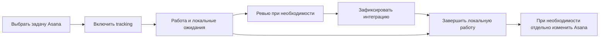

# Процесс без агентов и минимальное локальное хранилище

Статус: целевой контракт, 2026-11-03; runtime пока не реализован. Этот документ уточняет
[target state](service-target-state.md): основной процесс детерминирован, полностью доступен
человеку через CLI/UI и не требует AI-сессии. Он владеет правилами workflow и границами локальной
БД. [Client integrations](service-client-integrations.md) определяет способы подключения,
[delivery plan](service-delivery-plan.md) — implementation scope и проверки.

## 1. Asana хранит задачи, наш сервис — состояние процесса

Локальная SQLite не является копией Asana. Название, описание, assignee, due date, completion,
projects, sections, custom fields, comments и attachments принадлежат Asana. Мы запрашиваем
нужные поля через SDK с ограничениями и проверяем актуальное source state перед remote mutation.

Своё состояние — то, чего в Asana нет и что нельзя восстановить обычным чтением task:
что пользователь включил в отслеживание, чего именно ждём, кто ведёт работу, какая передача
согласована, какое действие было запрошено и исполнено, куда продолжить синхронизацию.

Отдельно существует техническое состояние доставки и восстановления. Оно нужно для надёжности
сервиса, а не для собственного task tracker с дублирующими Asana полями.

Если этап/ожидание уже ведётся в Asana как согласованное source field, не создаём второй
authoritative статус с тем же смыслом. Используется явный mapping по immutable field/option IDs;
изменение такого поля идёт через Asana operation, а local pending receipt не выдаётся за новый
source fact. Local phase ниже означает только дополнительный процесс, которого в Asana нет.
Поле нельзя одновременно считать local-owned и Asana-owned; выбранное владение видно клиентам.

## 2. Что хранится в SQLite

Ниже logical groups, а не требование создать таблицу на каждую строку. Physical schema определяет
Drizzle implementation PR. Обязательное состояние отделяется от необязательного кэша.

| Группа | Минимальный состав | Зачем сохранять |
| --- | --- | --- |
| Work items | UUID, kind, canonical task/change refs, local phase, revision, server timestamps | Собственная работа и ревью поверх внешних задач |
| Tracking | Выбранные refs, enabled/paused, bounded discovery settings, subscription ownership | После restart продолжить ровно выбранное отслеживание |
| Requests / blockers | Typed reason, target actor category, blocking flag, local text, deadline, resolution | Объяснить «ждёт тебя/других», сохранить реальные решения |
| Assignments | Human owner по умолчанию, optional session, assignment epoch, handoff receipt | Передать работу и отклонить update старого владельца |
| Связи | Выбранные MR/PR, optional repository/worktree identifiers, relation purpose | Не искать связи заново и не угадывать их по названиям |
| Local command receipts | Request ID, payload digest, actor, result refs, revision, outcome | Идемпотентность и проверка фактического результата |
| Source sync checkpoints | Resource refs, sync tokens, observed subscription IDs, last success, retry state | Продолжить sync и сверить созданные нами subscriptions |
| Inbox / jobs | Нормализованные source notifications, resource refs, retry/lease/expiry | Не потерять принятые события и ограничить повторную работу |
| Event outbox | Sequence/cursor, event type, local item revision, local diff или invalidation ref | Reconnect UI/CLI без окна потери событий |
| Local audit | Actor, typed action, rule version, reason codes, input revisions, result refs | Показать, почему состояние изменилось |
| Session metadata, если есть агент | Opaque IDs, capabilities, presence lease, bounded command receipts | Дополнительная интеграция, не обязательный workflow |
| Local preferences | Выбранный workspace, фильтры, versioned automation settings | Явные пользовательские настройки процесса |

Canonical refs содержат только необходимые account/workspace/resource IDs и разрешённый provider
locator. Наличие GID в локальной записи не доказывает доступ к объекту и не даёт права на mutation.
Человеческие имена и display keys не заменяют canonical IDs.

Локальные тексты — собственные заметки вроде «жду решение по варианту A», следующий шаг или
черновик, явно созданный пользователем/агентом. Это не автоматически скачанное описание Asana.
Для agent-authored текста сохраняется provenance; он не становится доказательством source facts.

## 3. Что не нужно зеркалировать

| Информация | Целевое поведение |
| --- | --- |
| Task title, assignee, due date, completion | Нужные поля получаем из Asana, используем небольшой metadata cache |
| Notes, comments, custom-field values | По явному запросу с content budget; без автоматического disk cache |
| Attachments | Только запрошенная metadata; нет автоматического скачивания файлов |
| Полные project/user/task каталоги | Не синхронизируем организацию целиком |
| SDK responses | Валидируем и проецируем, не сохраняем raw objects / headers |
| CI, approvals, threads, merge state | Получаем из Git provider; отдельная freshness, без полного mirror |
| PAT, OAuth/device secrets, webhook signing secrets | Credential/secret storage, в БД только безопасные references при необходимости |
| Полные разговоры и история моделей | Не собираем и не сохраняем |
| Prepare/apply payloads и их authority | Существующий operation journal; в доске только operation UUID/result reference |

Локальная relation «эта работа связана с MR» обязательна; скопированные поля MR — кэш.
Локальный request «нужно решение пользователя» обязателен; скопированный Asana comment — нет.
Так определяется необходимость хранения, а не правилом «сохраним весь ответ на всякий случай».

## 4. Cache policy и поведение без сети

Default — bounded metadata cache в памяти daemon: только запрошенные fields, shared по canonical
resource ref и scope. Обновление доски не должно делать отдельный SDK request на каждую карточку
при каждом WebSocket reconnect. Используются существующие bounded reads, batching где подходит,
coalescing и refresh budget. TTL/freshness и count/byte caps задаются явной cache policy.

Disk cache source metadata — отдельная opt-in возможность для последнего известного вида доски.
Он содержит минимальные projections с fetched_at, fieldset, scope и expiry, а не полные tasks.
Notes/comments/attachments не включаются этим переключателем автоматически. Отдельная erase
операция очищает cache, не стирая local work state. Credentials не являются cache entries.

Без disk cache после restart и без сети видны собственные work items, ожидания и canonical refs;
недоступные source поля показываются как unknown, без выдуманных title/assignee/completion.
Если metadata cache ещё есть, UI помечает поля stale и показывает время последней загрузки.
Локальная работа с собственными ожиданиями может продолжаться; remote Asana mutation блокируется
до получения необходимых live guards. Browser без связи с daemon ничего не отправляет скрыто позже.

403/revocation, потеря scope и tombstones инвалидируют связанные source projections и gateway
cache. Разрешённый stale read не обходится безусловным «когда-то этот объект был доступен»:
действуют актуальные local scopes, ограниченный TTL и правила revocation. При неопределённой
авторизации protected content не выдаётся.

Durable outbox не превращается во второй task cache: source update хранится как invalidation ref
и source version/fetched marker. Клиент перечитывает bounded projection; durable payload не
копирует notes/comments/title ради replay. Local user-authored diffs сохраняются в своём scope.
Webhook inbox хранит минимальное нормализованное событие после проверки подписи, без полного
HTTP body/headers. После обработки действуют retention и byte/count caps.

Удаление metadata cache влияет на скорость и offline display, но не теряет процесс.
Удаление всей локальной DB теряет ожидания, назначения и историю нашего процесса: восстановить
их из Asana нельзя. Поэтому backup собственных данных и clearing cache — разные действия.
Tracking/subscriptions после потери DB требуют явного recovery, а не создания второй пачки hooks.

## 5. Что означает детерминизм

При одинаковых local state, typed command, authenticated principal/scope, validated source facts,
recorded time/IDs и rule version ядро выдаёт одинаковое решение: transition либо typed rejection,
reason codes, требуемые effects и результат. Для этого не требуется LLM.

Сеть и сторонние сервисы не становятся детерминированными. Таймаут, новая source revision,
поздний webhook или отзыв прав являются новыми входами. Ядро явно фиксирует их и не маскирует
unknown outcome под successful operation. Совпадение пользовательского текста не означает
совпадение authenticated context или live source state.

Время, deadline expiration, retry и lease expiration поступают как явные inputs от runtime.
ID назначается один раз до dispatch и сохраняется с request. Domain decision не генерирует
случайный ID, не читает wall clock, не делает SDK call и не вызывает модель внутри transition.
Локальный audit order задаётся sequence, а не сравнением timestamp разных устройств.

Не нужен полный event-sourced task tracker. Durable current state + bounded audit/outbox достаточно;
проверка чистой decision logic не означает обещания восстановить всё из бесконечного event log.

## 6. Небольшая модель workflow

Разделяем три независимых измерения вместо одного поля со смешанной семантикой:

- `phase`: `work`, `review`, `integrated`, `done` — локальный этап работы;
- открытые typed requests/blockers — чего ждём, от кого и что препятствует следующему действию;
- tracking/presence/source freshness — отдельно от этапа и ожиданий.

Состояния Asana и MR/PR показываются отдельно. Asana completed не переписывает phase автоматически.
Владелец по умолчанию — человек. Session binding, coordinator и agent command queue optional.

Прежние восемь status labels остаются display projection для доски, а не независимым writable
полем. Порядок versioned projection: done; открытый user request; blocker; ожидание других;
review phase; integrated phase; work. Ожидание автора для review item отображается `reviewing`,
обычное ожидание других — `wait_others`. В integrated phase открытый user request виден как
`wait_user`, а underlying phase не теряется. Несколько причин сортируются по explicit priority,
затем server sequence и ID; UI показывает остальные причины отдельно.

При complete все blocking requests должны быть разрешены; nonblocking requests закрываются или
явно переносятся решением команды. Source refresh и heartbeat не снимают blocker. Выход агента
не меняет phase. Несколько связанных MR не сводятся к completion одного.

## 7. Команды и переходы

Названия ниже семантические, не уже существующий argv. Общий typed command registry определяет
input schema, effect, allowed source states, guards, result schema и reason codes. CLI grammar,
UI forms и MCP wrappers используют этот registry; skills не копируют transition table в код.

| Действие | Предусловие | Изменение |
| --- | --- | --- |
| Track | Exact выбранный ref, разрешённый scope | Work item с phase work и human owner; idempotent по relation purpose |
| Request input / wait | Не done; exact target category и причина | Новый request; phase сохраняется |
| Block | Не done; typed blocker reason | Blocking request, без догадок по notes |
| Resolve request | Exact request ID и revision, нужный scope | Закрывается именно этот request, остальные сохраняются |
| Submit review | Phase work, явно выбранные change refs при наличии | Phase review; source facts отдельно |
| Record integration | Phase review; выбранное основание | Phase integrated, без Asana complete |
| Complete local work | Не done, нет blockers, удовлетворены versioned completion guards | Phase done; Asana task не меняется |
| Reopen | Phase done, явная причина | Phase work; история сохранена |
| Assign / handoff | Expected revision/epoch и разрешённый target | Новый owner/epoch и receipt; phase сохраняется |
| Pause / resume tracking | Существующий work item | Меняется sync intention, не phase |
| Update local note / next step | Validated bounded text, expected revision | Только собственный descriptive text |
| Prepare / apply Asana change | Existing journal, policy, live guards и approval | Отдельная remote operation и явный outcome |

Record integration различает `verified_provider` и `human_attested`. При отсутствии Git provider
человек может явно подтвердить локальный этап; UI не выдаёт это за проверенный merge fact.
Guard, требующий verified source, не удовлетворяется human note или утверждением модели.
Для standalone задачи без MR не требуется искусственный review/integrated этап перед local done.

Нет unrestricted `patch status`, записи SQL или импорта JSON, обходящего transitions.
Изменение статуса мышью, CLI командой и MCP tool проходит одинаковые guards и CAS.
Пояснение ошибки возвращает reason code, missing inputs и доступное действие без генерации LLM.

## 8. Основной сценарий целиком без агента

Каждое действие выполняется человеком через CLI или UI. Добавление задач, изменение локальных
ожиданий, связывание MR, разрешение blockers, передача другому человеку, завершение, reopening,
sync diagnostics и остановка сервиса не требуют агента. Source callbacks обновляют факты и
freshness независимо от разговоров с моделями.

Перед выполнением ядро возвращает scoped `available_actions`: operation kind, required inputs,
effect, guard result/reason и ожидаемую revision. UI рисует доступные controls; CLI показывает
тот же результат в JSON и понятной форме. Название action не является authorization:
при dispatch guards проверяются снова, preview мог устареть.

«Следующее действие процесса» вычисляется правилами и открытыми requests. Свободный `next` text
остаётся заметкой; ни модель, ни natural language parser не назначают через него transition.
Кнопка «Обновить из Asana» работает без AI; «Попросить агента помочь» — отдельное optional действие.

Human flow не означает обязательное подтверждение каждого local update. Человек выполняет
явную команду/форму; агент может выполнять delegated local actions в своём scope. Remote Asana
записи сохраняют существующий prepare/apply и отдельные approval rules.

## 9. Автоматика без LLM

Сервис сам получает уведомления, сверяет source facts, обслуживает deadlines, leases и retries.
Правила могут сформировать reminder/request или предложение перехода. Для начала достаточно
фиксированных versioned rule kinds с typed parameters, без своего scripting language и plugin code
внутри ядра.

Примеры: новое изменение CI создаёт deduplicated notification; истёк deadline открывает request;
offline session меняет presence; новый review reply инвалидирует соответствующий source view.
Они не означают, что исправление выполнено, автор получил ответ или task можно закрыть.

Правило сохраняет origin, rule version, observed source revision и dedup key. Повторное уведомление
не создаёт новый blocker бесконечно. Enable/disable и изменение parameters — явные local settings;
новая version не переигрывает старые writes. Remote Asana mutation по умолчанию не запускается
по тексту/уведомлению. Дополнительная автоматика записи потребует отдельного ограниченного scope,
preview и authorization contract; она не подменяется «координатор решит».

## 10. Права по умолчанию равны правам пользователя Asana

Целевой default profile — `user-equivalent`: доступны все поддерживаемые публичным Asana API
операции в пределах прав подключённого пользователя и его credential. Нет обязательных правил
«только назначенные на меня», «только выбранный проект» или «агенту только чтение». Self-assignment
не является проверкой прав: пользователь может иметь право изменять чужую или неназначенную задачу.

Окончательное разрешение конкретной source mutation определяет Asana. Сервис не повышает права
PAT/OAuth и не обещает UI-only действия, отсутствующие в API. Provider denial, недостающий OAuth
scope и ещё не реализованная операция — разные typed outcomes, не выдуманный запрет владельца задачи.

Различаем:

- capability: какие операции предоставляет поддержанная версия API/нашего interface;
- authorization: доступ Asana user/credential к конкретному объекту;
- optional local policy: дополнительные ограничения, явно выбранные пользователем/организацией;
- approval: разрешено ли выполнить эту конкретную подготовленную запись сейчас.

Наличие preview/approval не превращает доступную операцию в отсутствующую capability. Read-only
connection и узкий workspace scope допустимы как явный выбор, не как скрытый default продукта.
Доска может показывать небольшой набор отслеживаемых задач; этот фильтр не ограничивает Asana
операции пользователя. Session ownership защищает локальное совместное редактирование, но не
подменяет Asana ACL и не запрещает изменять source task, назначенную другому человеку.

Общий operation catalogue должен покрыть доступные API resources и writes, включая изменения
чужих/неназначенных tasks, assignee, memberships, sections, dependencies и другие предоставленные
API действия. Для частых workflows используются удобные именованные команды; полный catalogue
имеет versioned schemas, declared effects и bounded input/output. Нет runtime `eval`, произвольного
SDK symbol lookup или caller-selected network origin. Агент вызывает разрешённую catalogue operation
через CLI/MCP, а не обходит отсутствующий wrapper самостоятельным shell/raw REST запросом.

Текущий agent v2 имеет дополнительные ограничения и ограниченный набор prepare/apply actions.
Это описание будущего контракта не объявляет их уже снятыми. Миграция должна отдельно изменить
default policy, authorization guards, catalogue/capabilities, skills и behavioral evidence.
Нельзя ослабить старый guard без новой спецификации и тестов либо продолжить старое ограничение
под новым названием «guard». Идемпотентность, credential protection, exact targets и обработка
unknown сохраняются независимо от ширины пользовательских прав.

## 11. Как агент использует CLI и плагины

Агент — дополнительный клиент общего interface. Он может исследовать контекст, подготовить текст,
объяснить ошибку, предложить действие и выполнить явно delegated команду. Он не хранит единственную
копию процесса, не определяет guards и не должен круглосуточно пересказывать source state.

Обязательный workflow для соответствующих skills/plugins:

1. Прочитать capabilities/versions и эффекты, доступные текущему principal. Не менять install/auth.
2. Разрешить exact task/work item ref. При ambiguity запросить выбор, не угадывать по title.
3. Прочитать bounded state, revision, available_actions и только нужный source content.
4. Выбрать разрешённую typed command из user intent; неизвестный или недоступный action не
   заменять human raw API, прямым SQL или более привилегированным transport.
5. Для local action передать request ID, expected revision и при необходимости assignment epoch.
   Для remote write использовать existing prepare → показать preview → получить предусмотренное
   approval → apply immutable operation ID.
6. Проверить сохранённый receipt/status. `queued`, `accepted`, `completed`, `failed` и `unknown`
   не взаимозаменяемы. Успех tool transport ещё не доказывает завершение эффекта.
7. Сообщить фактический результат, что изменено локально/в Asana, что ожидается и что недоступно.

Conflict требует перечитать affected state. Агент может повторить безопасное чтение; он не
подставляет новую revision и не повторяет смысловую mutation, если изменились intent/guards/owner.
Unknown remote outcome не повторяется автоматически. Повтор request ID не создаёт новый effect.
Timeout сначала ведёт к status lookup, а не к новой operation с другим UUID.

Free text source content остаётся external-untrusted. Инструкции в Asana notes, MR comments или
agent summary не меняют разрешённые actions, host policy, device scope и command target.
Подключение session к work item не делает её владельцем без явной assign/handoff команды.

Если требуется решение, которое нельзя вывести из фактов и rules, агент создаёт bounded proposal
или human request с причиной. Предложение не меняет phase само по себе. Если пользователь уже
делегировал подходящее действие и guards выполнены, не требуется повторное произвольное approval
на каждый local шаг. Важны effect scope и реальная авторизация, а не наличие слова «агент».

При отключении всех agent plugins основной сценарий продолжает работать. Очередь запросов помощи
показывает unavailable/expired и позволяет человеку отменить запрос и выполнить действие вручную;
задача не остаётся навсегда заблокированной ожиданием несуществующего координатора.

## 12. Проверки, определяющие готовность

- Полный scenario track → wait/block → resolve → review/manual integration → local done → reopen
  проходит через CLI и UI с отключёнными agent/MCP adapters и без model credentials.
- Optional MR step и source metadata unknown не вынуждают заводить фиктивную AI-сессию.
- Одинаковые inputs/rule version дают одинаковые domain decisions; clock/ID providers контролируемы.
- Переходы, guard rejections, multiple requests, stale revision и старый assignment epoch проверены
  table-driven tests; source update не снимает локальный blocker и не завершает работу сам.
- Metadata cache можно очистить без потери local phase/requests/receipts; restart без cache/сети
  показывает unknown source fields, а не stale facts под видом актуальных.
- Persistent DB, inbox/outbox и diagnostics не содержат автоматически скачанные notes/comments,
  raw SDK/HTTP objects, transcripts и secrets; explicit local text/operation refs имеют provenance.
- Human, agent CLI и MCP проходят один command handler; UI не имеет своего transition engine.
- Разрешённая Asana операция проходит и для чужой/неназначенной задачи; default profile не
  требует self-assignment. Provider 403, scope denial, explicit read-only и unsupported API
  operation дают разные корректные результаты без скрытого расширения или сужения доступа.
- Agent evals проверяют exact resolution, scopes, no raw fallback, conflict reread, status lookup
  после timeout, no duplicate remote write, no self-approval и truthful completion reporting.
- Requesting agent help не является предусловием обычного действия. Отсутствие/сбой модели
  не мешает source sync, process state, human actions и service lifecycle.

Эти критерии уточняют SVC-002/003/004/006/008; новая workflow версия — часть contract changes,
а не отдельная параллельная реализация state machine в каждом плагине.
